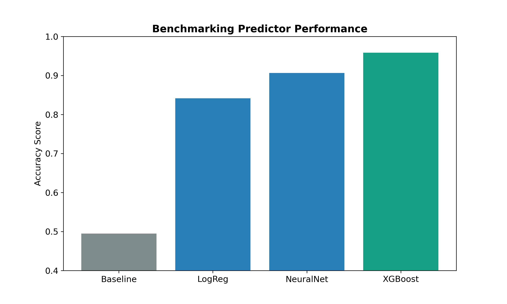
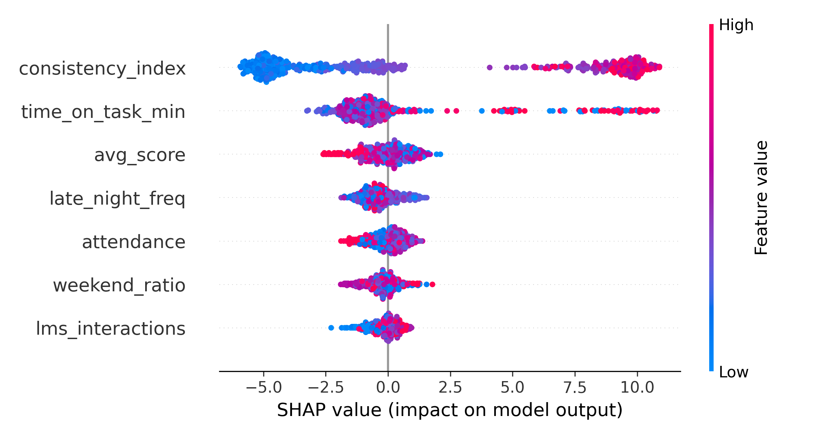

# Project Athenal

A privacy-preserving machine learning framework for predicting K-12 learning gaps using decentralized data.

## Overview

Schools collect large amounts of digital student performance data, but federal privacy regulations like FERPA prevent districts from pooling records into centralized cloud servers. This creates institutional data silos: smaller districts often lack sufficient data to train accurate early-warning models on their own.

Project Athenal evaluates whether a Federated Learning (FedAvg) pipeline can achieve strong predictive performance while keeping raw student data strictly local. The system couples an edge-optimized gradient boosted classifier (XGBoost) with a custom behavioral metric (the Consistency Index) and SHAP explainability.

## Documentation

- 📄 [View Research Presentation Deck (PDF)](docs/Project_Athenal_Presentation.pdf)

## Key Features

- **Consistency Index (CI)**: Rather than relying only on past exam scores (lagging indicators), the pipeline extracts behavioral volatility. CI measures the standard deviation of submission timestamps relative to assignment deadlines ($\Delta t = T_{\text{due}} - T_{\text{submitted}}$).
- **Federated Averaging (FedAvg)**: Models train locally across three simulated, non-IID school districts. Only model coefficients are transmitted, eliminating direct PII transfer.
- **Explainable AI (SHAP)**: Global feature attribution via TreeSHAP to verify which behavioral indicators drive risk classifications.
- **Edge Deployment**: The compiled model is under 5MB with sub-10ms inference latency, targeting low-cost classroom hardware like Chromebooks.

## Benchmark Results

Trained and evaluated on balanced multi-district synthetic populations ($N = 3{,}000$ total records):

| Model Architecture | Accuracy | ROC-AUC | Description |
|---|:---:|:---:|---|
| Baseline | 49.50% | 0.500 | Majority class control |
| Logistic Regression | 84.17% | 0.896 | Linear baseline |
| Neural Network (MLP) | 90.67% | 0.964 | 2-layer perceptron (8x4 hidden layers) |
| **XGBoost (Production)** | **95.83%** | **0.982** | Tuned gradient boosted trees (depth=6, n=150) |
| **Federated Model (FedAvg)** | **84.33%** | — | Decentralized weights, zero PII transfer |

The 11.5% accuracy gap between centralized XGBoost (95.83%) and decentralized FedAvg (84.33%) quantifies the practical trade-off between peak model performance and data sovereignty.

## Visualizations

### Model Accuracy Comparison


### SHAP Feature Attribution


## Getting Started

### Prerequisites
Install dependencies:
```bash
pip install -r requirements.txt
